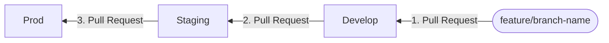

# Branch and PR patterns

## Branching Strategy

Our primary codebase is in the [`artsgoz/artsgoz-monorepo`](https://github.com/artsgoz/artsgoz-monorepo.git).

We maintain 3 core branches that directly map to our cloud platform environments. This structure ensures that code is thoroughly tested before reaching our end users:

- **Prod**: Represents the **live Production environment**. Code here must be highly stable and production-ready.
- **Staging**: Represents the **Staging environment**. This is used for final pre-production testing, QA, and client reviews.
- **Develop**: Represents the **Development environment**. This is our active integration branch where new features and bug fixes are merged first.

```mermaid
gitGraph
    commit id: "Initial Prod"
    branch Staging
    branch Develop

    %% Developer works on a feature
    checkout Develop
    commit id: "Current state"
    branch feature/ticket-name
    checkout feature/ticket-name
    commit id: "Work on task"
    commit id: "Finish task"

    %% Merge to Develop
    checkout Develop
    merge feature/ticket-name id: "PR to Develop"

    %% Promote to Staging
    checkout Staging
    merge Develop id: "PR to Staging"

    %% Promote to Prod
    checkout prod
    merge Staging id: "PR to Prod"
```

## How to Create a Feature Branch (For Beginners!)

<mark>Whenever you start working on a new task, bug fix, or feature, you should create a new "feature branch."</mark> Think of a branch as your own personal sandbox. you can write code, make mistakes, and experiment without breaking the main code that everyone else is using.

Since all new features go into the `develop` branch first, you must always create your new branch from `develop`.

### Step 1: Get the latest code

Before you create a branch, make sure your computer has the most up-to-date version of the Develop branch. Open your terminal (or command prompt) and run:

```bash
# Switch to the Develop branch
git checkout develop

# Download the latest updates from GitHub
git pull origin develop
```

### Step 2: Create and switch to your new branch

Now that you are up to date, create your new branch. We use the `git checkout -b` command, which creates the branch and immediately moves you into it.

```bash
git checkout -b feature/your-branch-name
```

> {: .tip }
> Naming Your Branch
> Keep the name short but descriptive. If you are working on a specific ticket, include the ticket number!
>
> - `Good`: feature/login-button or feature/task-123
> - `Good`: fix/header-typo (if it's a bug fix)
> - `Bad`: my-branch or code-update

Check this, [Branch Naming](../reference/git/gh-issue/index###Development)

### Step 3: Publish your branch to GitHub

Right now, your branch only exists on your computer. To back it up to GitHub (and allow you to open a Pull Request later), you need to "push" it for the first time:

```bash
git push -u origin feature/your-branch-name
```

or you can just `git push`

## Pull Request (PR) Patterns

When you draft a PR, it already has a template for you to follow. Please fill it out thoroughly to provide context for your reviewers. Also, carefully check that you are pointing your PR to the correct target branch before submitting.

> {: .warning }
> CHECK TARGET BRANCH CAREFULLY
> Please check that you are pointing your PR to the correct target branch before submitting.


