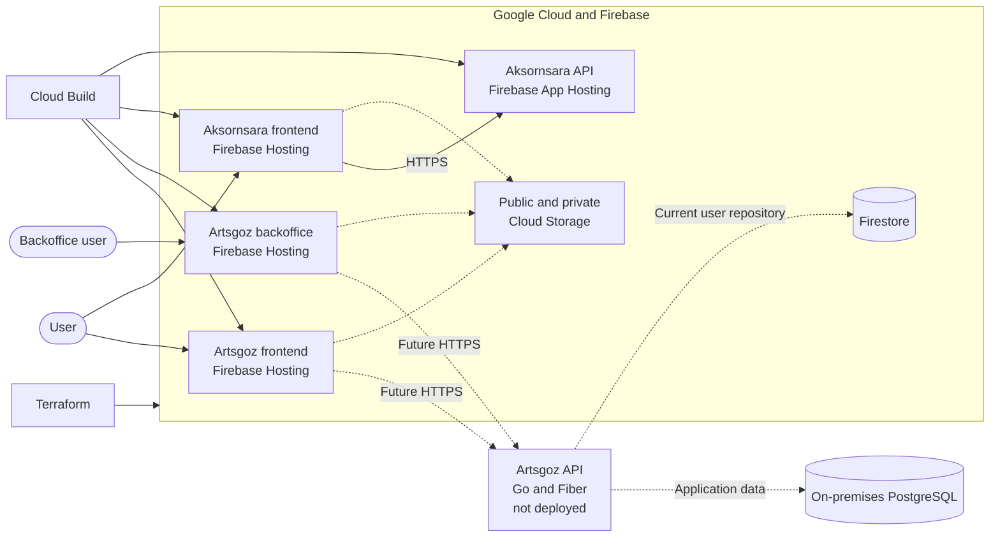
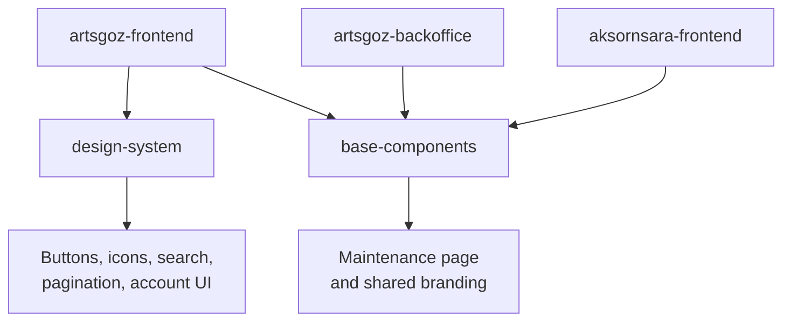
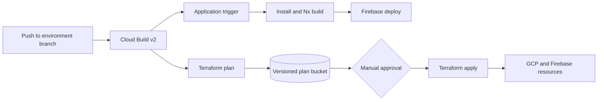

# System Architecture

This page describes the application landscape across two repositories:

- [`artsgoz/artsgoz-monorepo`](https://github.com/artsgoz/artsgoz-monorepo) contains the Artsgoz and Aksornsara frontends, the Aksornsara API, shared frontend libraries, deployment pipelines, and Terraform infrastructure.
- [`artsgoz/artsgoz-backend`](https://github.com/artsgoz/artsgoz-backend) contains the Go API for Artsgoz. This API is under development and has not been deployed.

{: .note }

> This document reflects the repository as reviewed on October 12, 2026.

## Architecture

The frontend workspace is an Nx monorepo containing three browser applications, the Aksornsara API, shared UI libraries, and Terraform infrastructure. The Artsgoz API is developed separately in its own Go repository.

| Layer            | Technology                                           | Purpose                                                                |
| ---------------- | ---------------------------------------------------- | ---------------------------------------------------------------------- |
| Web applications | React 19, Vite 8, TypeScript, React Router           | Public Artsgoz site, Artsgoz backoffice, and Aksornsara site           |
| Shared UI        | `@artsgoz/design-system`, `@artsgoz/base-components` | Reusable design-system controls, branding, and shared pages            |
| Artsgoz API      | Go 1.25, Fiber v3                                    | Artsgoz backend; under development and not deployed                    |
| Aksornsara API   | NestJS 11, Node.js 22                                | Aksornsara HTTP API under the `/api` prefix                            |
| Frontend hosting | Firebase Hosting                                     | Hosts the three Vite single-page applications                          |
| API hosting      | Firebase App Hosting                                 | Builds and runs the Aksornsara API                                     |
| CI/CD            | Google Cloud Build                                   | Builds and deploys applications and runs Terraform plans and applies   |
| Infrastructure   | Terraform on GCP                                     | Manages projects, Firebase resources, IAM, storage, and build triggers |
| Database         | On-premises PostgreSQL                               | Intended system of record for application data                         |

## System context



Dashed connections represent planned or incomplete runtime integration. The Artsgoz API is not deployed yet.

## Workspace structure

```text
artsgoz-monorepo/
├── apps/
│   ├── artsgoz-frontend/       Public Artsgoz
│   ├── artsgoz-backoffice/     Artsgoz backoffice
│   ├── aksornsara-frontend/    Public Aksornsara
│   ├── aksornsara-api/         NestJS API (for aksornsara only)
│   └── aksornsara-api-e2e/     API end-to-end tests
├── packages/
│   └── design-system/          Shared product UI components and assets
├── libs/
│   └── base-components/        Cross-application branding and shared pages
├── infra/
│   ├── cloudbuild/             Terraform plan and apply cloud build config
│   └── terraform/
├── firebase.json               Hosting and App Hosting targets
├── nx.json                     Nx task configuration
└── pnpm-workspace.yaml         Workspace package boundaries
```

### Applications

#### Artsgoz frontend

`apps/artsgoz-frontend` is the most developed application. It uses feature-oriented modules for articles, clubs, curriculum, forms, internships, professors, student services, and other public-facing functionality.

Page-level route modules assemble features under a shared `MainLayout`. React Router provides client-side routing, and Firebase Hosting rewrites unknown paths to `index.html` so direct navigation to SPA routes works. The application also initializes Thai and English translations before rendering.

#### Artsgoz backoffice

`apps/artsgoz-backoffice` is a separate Vite SPA intended for administrative workflows. It currently contains the generated Nx starter routes and a build-time maintenance-mode switch. It is deployed independently from the public Artsgoz frontend.

#### Artsgoz API

The Artsgoz API is not part of the monorepo. It is developed in [`artsgoz/artsgoz-backend`](https://github.com/artsgoz/artsgoz-backend) using Go 1.25 and Fiber v3.

The backend follows Domain-Driven Design and Clean Architecture. Business areas live under `internal/modules`, with separate domain, application, infrastructure, and interface layers. The current user module supports Firebase Authentication, Chulalongkorn email validation, role-based access, and Firestore persistence.

The repository also contains a pgx connection pool, PostgreSQL migrations, and GCP Secret Manager integration. PostgreSQL is planned as the on-premises system of record, but the current user repository still uses Firestore. The service has no deployed environment or production endpoint yet.

#### Aksornsara frontend

`apps/aksornsara-frontend` is a separate Vite SPA for the Aksornsara product. Cloud Build injects its API base URL and maintenance-mode setting during the build. The current application UI is still an early scaffold.

#### Aksornsara API

`apps/aksornsara-api` is a NestJS service bundled with Webpack and deployed through Firebase App Hosting. It listens on the platform-provided `PORT` and exposes routes below `/api`.

The current implementation contains only a health-like starter response. Authentication, domain modules, persistence, and PostgreSQL connectivity still need to be implemented.

### Shared libraries



- `@artsgoz/design-system` contains reusable controls, account components, icons, logos, and design tokens. The Artsgoz frontend consumes it as a workspace dependency.
- `@artsgoz/base-components` contains cross-application components. All three frontends currently use its maintenance page through the `@base-components` alias.
- Nx calculates project tasks and dependencies, while pnpm links workspace packages and maintains one lockfile.

## Environments and isolation

The platform has `dev`, `staging`, and `prod` environments. Each environment is triggered by its corresponding Git branch:

| Branch    | Environment | Purpose                              |
| --------- | ----------- | ------------------------------------ |
| `develop` | Development | Active integration and early testing |
| `staging` | Staging     | Pre-production validation            |
| `prod`    | Production  | Public production workloads          |

Artsgoz and Aksornsara use separate GCP/Firebase projects within every environment. This creates six independent product-environment boundaries and keeps IAM, Terraform state, hosting resources, storage, and deployment triggers isolated.

- **Artsgoz project:** public frontend, backoffice, public/private storage, and their Cloud Build triggers.
- **Aksornsara project:** public frontend, App Hosting API, public/private storage, and their Cloud Build triggers.

Regional resources default to `asia-southeast1`; Firebase App Hosting is configured in `asia-east1`. Service URLs are listed on the [Environments]({{ site.baseurl }}/infrastructure/environments/) page.

The Terraform roots in the monorepo do not currently provision or deploy `artsgoz/artsgoz-backend`.

## Delivery architecture



### Application delivery

Terraform creates file-filtered Cloud Build triggers for each application. A trigger runs only when its application, shared libraries, or workspace configuration changes.

- The three frontends install the frozen pnpm lockfile, build their Nx project, and deploy the generated `dist` directory to the corresponding Firebase Hosting target.
- The API trigger invokes Firebase deployment. App Hosting then performs the API build using the commands in `apphosting.yaml`.
- Maintenance mode and the Aksornsara API URL are passed into frontend builds as Vite environment variables.
- Application deployments use a Firebase deployer service account belonging to the target GCP project.

This application-delivery flow covers the monorepo workloads only. The Go-based Artsgoz API does not yet have a deployment pipeline.

### Infrastructure delivery

Terraform changes use a plan-then-apply workflow:

1. Cloud Build initializes the environment's GCS backend and creates a Terraform plan.
2. The binary plan and its text representation are stored under the commit SHA in a private, versioned plan bucket.
3. The apply trigger requires approval.
4. The approved job downloads and applies the exact saved plan.

Each product and environment has its own Terraform root, state bucket, plan bucket, service accounts, and triggers. A plan must never be reused across these boundaries.

## Current implementation status

| Area                | Status                                                                |
| ------------------- | --------------------------------------------------------------------- |
| Artsgoz frontend    | Active feature implementation                                         |
| Design system       | Shared component library in active use                                |
| Artsgoz backoffice  | Init Nx scaffold with maintenance mode                                |
| Artsgoz API         | under development in a separate repository; not deployed              |
| Aksornsara frontend | Initial scaffold with deployment configuration                        |
| Aksornsara API      | Init NestJS starter deployed through App Hosting                      |
| CI/CD               | Cloud Build definitions and Terraform-managed triggers present        |
| Infrastructure      | Separate Terraform roots for both products and all three environments |

## Related documentation

- [Infrastructure Architecture](../infrastructure/infrastructure/)
- [Terraform IaC](../infrastructure/terraform/index/)
- [Environments and service URLs](../infrastructure/environments/)
- [Branch and pull request workflow](../WoW/branch-and-pr/)
