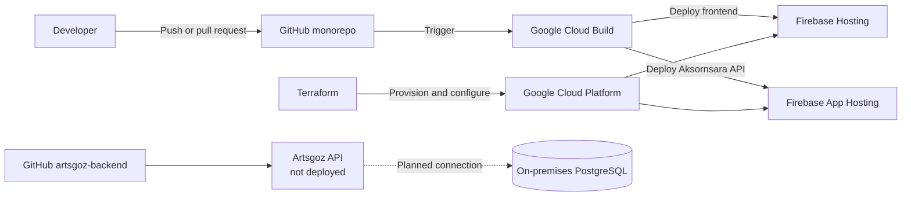

# Infrastructure Architecture

Artsgoz services run primarily on Google Cloud Platform (GCP). Frontend applications, the Aksornsara API, build configuration, and Terraform definitions are maintained in the [`artsgoz/artsgoz-monorepo`](https://github.com/artsgoz/artsgoz-monorepo). The Go-based Artsgoz API is maintained separately in [`artsgoz/artsgoz-backend`](https://github.com/artsgoz/artsgoz-backend) and has not yet been deployed.

## Platform overview

| Area                   | Platform              | Responsibility                                                                  |
| ---------------------- | --------------------- | ------------------------------------------------------------------------------- |
| Frontend hosting       | Firebase Hosting      | Hosts and serves the frontend applications.                                     |
| Aksornsara API hosting | Firebase App Hosting  | Builds and runs the NestJS Aksornsara API.                                      |
| Artsgoz API            | Go and Fiber          | Separate backend under development; no deployed environment yet.                |
| Database               | PostgreSQL (on-premises) | Stores application data on Artsgoz-managed infrastructure.                    |
| CI/CD                  | Google Cloud Build    | Builds, tests, and deploys changes.                                             |
| Infrastructure as code | Terraform             | Defines and manages cloud infrastructure.                                       |
| Cloud platform         | Google Cloud Platform | Provides the underlying projects, services, permissions, and runtime resources. |

## Architecture

The monorepo is the source of truth for its applications and infrastructure. Cloud Build provides their delivery path to Firebase, while Terraform manages the required cloud resources. The separate Artsgoz backend repository is not currently covered by this deployment pipeline.

## Hosting

### Frontend

Frontend applications are deployed to **Firebase Hosting**. Firebase Hosting provides the public entry point for each frontend and maps it to the domain for the target environment.

When changing frontend hosting configuration, check both the application configuration and the Firebase configuration in the monorepo. Verify the target environment before deploying.

### Aksornsara API

The NestJS Aksornsara API is deployed using **Firebase App Hosting**. App Hosting builds the API from the monorepo and runs it on managed Google Cloud infrastructure associated with the target environment.

Configuration that varies between environments, such as service endpoints or credentials, must not be hard-coded in source files. Store sensitive values using the secret-management mechanism configured for the service.

### Artsgoz API

The Artsgoz API is a Go 1.25 service built with Fiber v3 in [`artsgoz/artsgoz-backend`](https://github.com/artsgoz/artsgoz-backend). It follows Domain-Driven Design and Clean Architecture and currently includes Firebase Authentication, Firestore-backed user persistence, PostgreSQL scaffolding, migrations, and Secret Manager integration.

The Artsgoz API has **not been deployed**. Its hosting platform, environments, endpoint, deployment pipeline, and network connectivity to the on-premises PostgreSQL server still need to be defined.

## Database

Artsgoz application data is intended to use **PostgreSQL running on-premises**. The future Go API will provide the application boundary; frontend applications must access data through the API rather than connecting to PostgreSQL directly.

The backend repository already contains a pgx connection pool and an initial SQL migration. However, its current user module uses Firestore, and the service is not deployed, so production PostgreSQL integration is not yet complete.

Database credentials and connection details are sensitive and must not be committed to Git. Access should be limited to authorized people and services. Changes to the database server itself are managed separately from the GCP resources defined by Terraform.

## CI/CD with Cloud Build

Google Cloud Build is responsible for the CI/CD pipeline. A typical change follows this path:

1. A developer pushes a branch and opens a pull request in the monorepo.
2. Cloud Build runs the configured validation, build, and test steps.
3. After the change is merged into an environment branch, the deployment pipeline builds the relevant services.
4. Cloud Build deploys each monorepo service to its configured Firebase hosting platform.
5. The team verifies the deployment using the URLs listed on the [Environments](environments) page.

The `develop`, `staging`, and `prod` branches correspond to the development, staging, and production environments. See the [branch and pull request workflow](../WoW/branch-and-pr) before promoting a change.

This workflow does not yet deploy the Go-based Artsgoz API.

{: .warning }

> Always confirm the source branch, target branch, Google Cloud project, and deployment environment before starting or approving a deployment.

## Infrastructure management with Terraform

Terraform is the source of truth for managed cloud infrastructure. Infrastructure changes should be made through Terraform in the monorepo instead of being applied manually in the Google Cloud or Firebase consoles.

For each infrastructure change:

1. Update the relevant Terraform configuration in a feature branch.
2. Format and validate the Terraform files.
3. Review the Terraform plan and confirm that it affects only the intended environment.
4. Submit the change through the normal pull request process.
5. Apply the reviewed change using the team's authorized deployment process.
6. Verify the affected service after the change is complete.

If an emergency requires a manual console change, document it and reconcile it with Terraform as soon as possible. Otherwise, a later Terraform apply may overwrite the manual change or produce configuration drift.

## Operational guidelines

- Keep environment-specific resources isolated from one another.
- Grant the minimum permissions required for people and service accounts.
- Never commit credentials, private keys, or secret values to Git.
- Restrict PostgreSQL access to authorized services and administrators.
- Back up the on-premises database and periodically verify that backups can be restored.
- Review Cloud Build logs first when a build or deployment fails.
- Review the hosting service logs when a deployment succeeds but the application does not behave as expected.
- Make infrastructure changes through reviewed pull requests.
- Verify development and staging before promoting a change to production.

## Related documentation

- [Service environments and URLs](./environments)
- [Branch and pull request workflow](../WoW/branch-and-pr)
- [`artsgoz/artsgoz-monorepo`](https://github.com/artsgoz/artsgoz-monorepo)
- [`artsgoz/artsgoz-backend`](https://github.com/artsgoz/artsgoz-backend)
